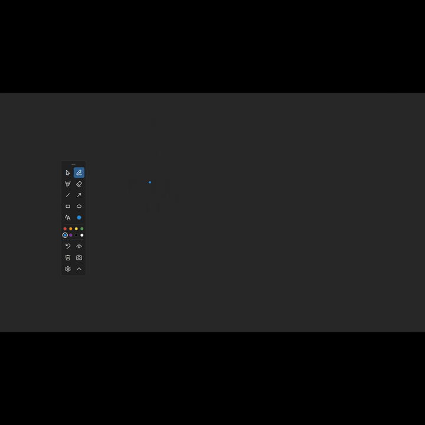
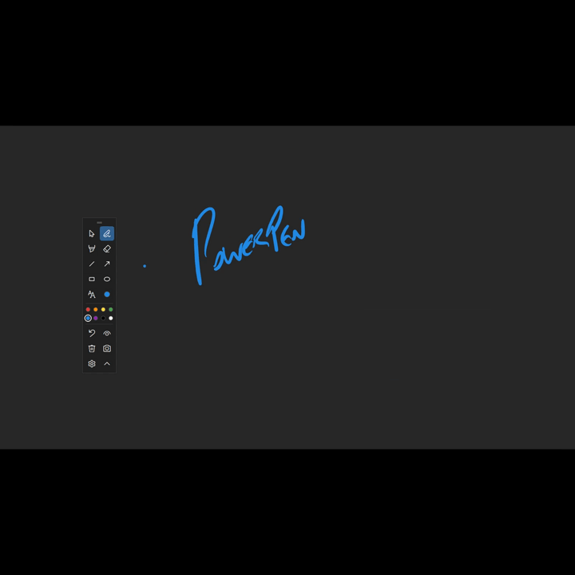
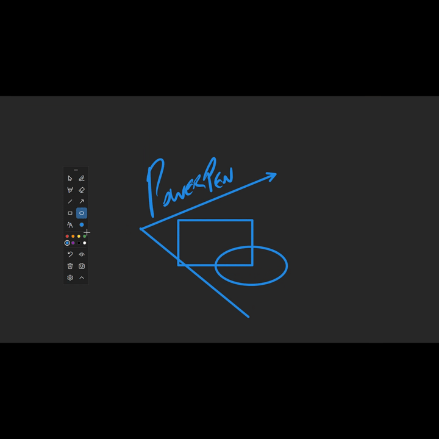

# PowerPen

Draw on top of anything on your screen, on any monitor, then take a screenshot of it. A free, lightweight screen annotation tool for Windows, in the style of Epic Pen.

- Pen, highlighter, eraser, lines, arrows, rectangles, ellipses, and text
- Works across multiple monitors, including mixed display scaling
- Global hotkeys, plus single-key shortcuts while drawing
- Screenshot an area or a whole screen, with your drawing included
- One `.exe`: no installer, no admin rights, no .NET install, no network access

**Requirements:** 64-bit Windows 10 or 11.

---

## Install

1. Download `PowerPen-<version>.zip` from the [latest release](https://github.com/Rhino1093/PowerPen/releases/latest) and unzip it.
2. Copy **PowerPen.exe** anywhere you like, for example `Documents\Tools`.
3. Double-click it.
   - The exe isn't code-signed, so Windows shows **"Windows protected your PC"** the first time. Click **More info → Run anyway**.
4. The toolbar appears at the top-left of your main monitor, and the PowerPen icon appears by the clock.
5. Optional: ⚙ Settings → **Start PowerPen when Windows starts**.

---

## The basics

PowerPen has two modes:

| Mode | What happens |
|---|---|
| **Pointer** (the arrow button) | Your drawing stays on screen, and clicks go to your apps as normal. |
| **Drawing** (any tool or color) | Your mouse draws. Press **Esc** to go back to Pointer. |

- When you stop drawing, the app you were using gets the keyboard back. For example, a PowerPoint slideshow keeps responding to the arrow keys.
- Undo covers every monitor. **Clear all** can be undone too.

### See it in action

Lines, arrows, and rectangles:

Ellipses and text:

---

## The toolbar

| Button | What it does |
|---|---|
| ↖ Pointer | Stop drawing; clicks go to your apps |
| ✎ Pen · ▮ Highlighter · ⌫ Eraser | Draw freehand, highlight, or erase whole strokes (and text) |
| ╱ Line · ↗ Arrow · ▭ Rectangle · ⬭ Ellipse | Drag to draw. **Hold Shift** for straight 45° lines, squares, and circles |
| A Text | Click where you want to type. **Enter** finishes, **Shift+Enter** starts a new line, **Esc** cancels |
| ● Size | Thin / medium / thick, for lines and text. The dot shows the current size and color |
| Color dots | Pick a color (and start drawing) |
| ↶ Undo | Undo the last change |
| 👁 Hide / show ink | Hide your drawing without deleting it. The button lights up while ink is hidden |
| 🗑 Clear all | Remove all drawing on every monitor (undoable) |
| 📷 Screenshot | See [Screenshots](#screenshots) |
| ⚙ Settings | Colors, sizes, hotkeys, screenshot folder |
| ▴ Collapse | Shrink to one button (lit while drawing). Click it to get the toolbar back |

- Drag the toolbar by the bar at its top. It remembers where you left it.
- Hover over any button to see its shortcuts.

---

## Keyboard shortcuts

**From any app** (change them in ⚙ Settings):

| Keys | Action |
|---|---|
| `Ctrl+Alt+D` | Start / stop drawing |
| `Ctrl+Alt+1` … `8` | Start drawing in color 1–8 |
| `Ctrl+Alt+I` | Hide / show ink |
| `Ctrl+Alt+C` | Clear all |
| `Ctrl+Alt+Q` | Quit PowerPen |

**While drawing:**

| Key | Action | Key | Action |
|---|---|---|---|
| `P` | Pen | `1`–`8` | Color |
| `H` | Highlighter | `[` / `]` (or `-` / `=`) | Thinner / thicker |
| `E` | Eraser | `Ctrl+Z` / `Ctrl+Y` | Undo / redo |
| `L` | Line | `Delete` | Clear all |
| `A` | Arrow | `Esc` | Stop drawing (or cancel the shape/text in progress) |
| `R` | Rectangle | `Shift` while dragging | Straight / square / circle |
| `O` | Ellipse | `T` | Text |

- `Ctrl+Alt+D` only switches between drawing and Pointer. It keeps whichever tool you used last, so if you switched to the eraser, you'll come back to the eraser. Press `P` to get the pen back.
- **Pen tablets:** map a tablet button to `Ctrl+Alt+D` and the pen buttons to `P` and `E` to switch between pen and eraser.

---

## Screenshots

1. Click **📷** on the toolbar. Every monitor freezes and dims.
2. Choose what to capture:
   - **Drag** to capture an area. The size in pixels is shown as you drag.
   - **Click** to capture that whole screen. This works on any monitor.
   - **Esc** or **right-click** cancels.
3. The picture is saved as a PNG in your **Downloads** folder (for example `PowerPen_2026-10-07_143205.png`) and copied to the clipboard, so you can paste it straight into chat or email.
4. A notice appears in the corner. Click it to open the folder.

The toolbar never appears in screenshots or in Teams/Zoom screen sharing. You can turn this off in Settings.

---

## Settings

Open them with **⚙** on the toolbar, or right-click the PowerPen icon by the clock → **Settings…**. Changes apply as soon as you click **Save**.

- **Colors:** up to 8. Click a circle to pick a color, or type a code like `#E53935`.
- **Sizes:** line widths, and how much wider the highlighter is.
- **Hotkeys:** click a box and press the keys. **Backspace** turns a hotkey off.
- **Screenshots:** the save folder (empty = Downloads), copy to clipboard, and hide the toolbar from captures.
- **Start with Windows.**

Settings are stored in `%AppData%\PowerPen\settings.json`.

---

## Tips and limits

- **Teams / Zoom:** others only see your drawing if you share your **whole screen**, not a single window.
- **Each monitor has its own drawing.** A single stroke can't cross from one monitor to another.
- **Plugging in or unplugging a monitor clears the drawing.**
- **Finished text can't be edited.** Erase it and type it again.
- **Full-screen games and some video players** can cover the drawing.
- **Night light** (and some HDR or color settings) can be included in screenshots. On some PCs, Windows applies the warm tint before any app can capture the screen, so screenshots taken while Night light is on look warmer.
- **Non-US keyboards:** on many European layouts `Ctrl+Alt+number` types characters like `@` or `{`. Change the color hotkeys in Settings, for example to Ctrl+Alt+Shift.
- **Global hotkeys win over app shortcuts.** While PowerPen runs, Word's `Ctrl+Alt+1/2/3` (headings) and `Ctrl+Alt+C` (©) go to PowerPen. Change them in Settings if you need them.
- **Pen pressure** works but PowerPen was built and tested mainly with a mouse.

---

## If something goes wrong

**"… is already used by another app"**
Another program owns that key combination. Open ⚙ Settings and pick a different one.

**The toolbar is gone**
Click the PowerPen icon by the clock, or just start PowerPen again.

**Something else**
1. Right-click the PowerPen icon → **Exit PowerPen**.
2. Press `Win+R` and enter `"C:\path\to\PowerPen.exe" --selftest`. It takes about 30 seconds and moves the mouse by itself. Don't touch the mouse or keyboard until it's done.
3. [Open an issue](https://github.com/Rhino1093/PowerPen/issues) describing what happened, and attach:
   - the report, `%TEMP%\PowerPen-selftest.txt`;
   - the logs: right-click the PowerPen icon → **Open log folder**.

The self-test never saves pictures of your screen and never touches your clipboard. The report and logs contain your Windows version, monitor layout, and file paths (which can include your Windows username). Look them over before attaching.

**Reset everything**
Exit PowerPen and delete `%AppData%\PowerPen\settings.json`.

---

## Uninstall

1. ⚙ Settings → untick **Start PowerPen when Windows starts** → Save.
2. Right-click the PowerPen icon → **Exit PowerPen**.
3. Delete `PowerPen.exe` and the folder `%AppData%\PowerPen`.

---

## For developers

**Prerequisites:** Windows 10/11 and the [.NET 10 SDK](https://dotnet.microsoft.com/download/dotnet/10.0). Built with WPF (`InkCanvas`) and [CommunityToolkit.Mvvm](https://github.com/CommunityToolkit/dotnet).

| Task | Command |
|---|---|
| Build | `dotnet build PowerPen.slnx` |
| Unit tests | `dotnet test PowerPen.slnx` |
| Run | `dotnet run --project src/PowerPen` |
| Self-test (real input, all monitors) | `PowerPen.exe --selftest [report.txt]` |
| Render the UI to PNGs (layout checks) | `PowerPen.exe --render-ui [folder]` |
| Build the release exe + zip | `powershell -ExecutionPolicy Bypass -File publish.ps1` |
| Regenerate the app icon | `powershell -STA -ExecutionPolicy Bypass -File tools\make-icon.ps1` |

The design, decisions, and build history are in [PLAN.md](PLAN.md).

---

## License

[MIT](LICENSE). Free to use, change, and share.
